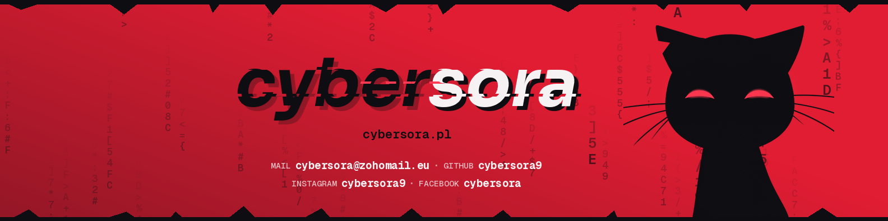

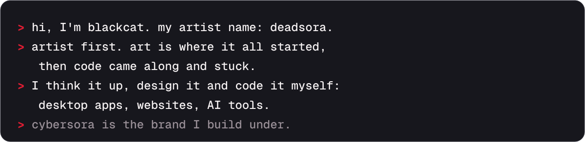

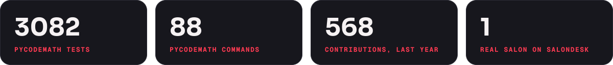

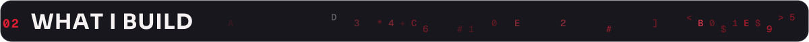

<table>
<tr>
<td width="50%"><a href="https://github.com/cybersora9/pycodemath">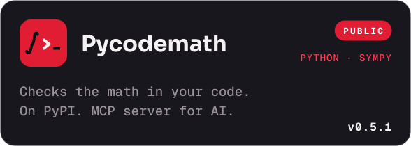</a></td>
<td width="50%"><a href="https://cybersora.pl">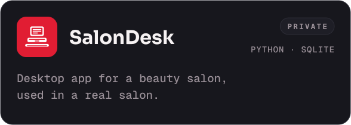</a></td>
</tr>
<tr>
<td width="50%"><a href="https://cybersora.pl">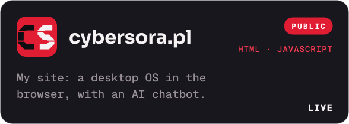</a></td>
<td width="50%"><a href="https://cybersora.pl">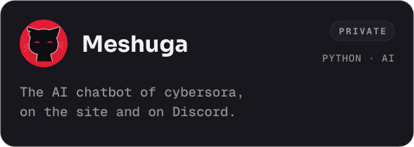</a></td>
</tr>
<tr>
<td width="50%">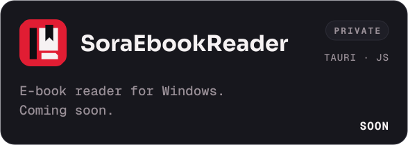</td>
<td width="50%">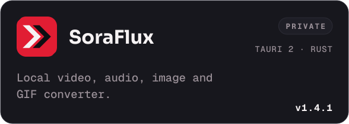</td>
</tr>
</table>

<b>New: <a href="https://github.com/cybersora9/pycodemath/releases/tag/v0.5.1">Pycodemath 0.5.1</a></b> · 88 commands in 11 sections · <code>certify</code> finds the root SymPy's <code>solve</code> drops in <code>exp(x) = 3x</code> · MCP server for AI agents (9 tools)

<table>
<tr>
<td width="50%"></td>
<td width="50%"></td>
</tr>
</table>

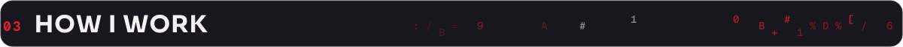
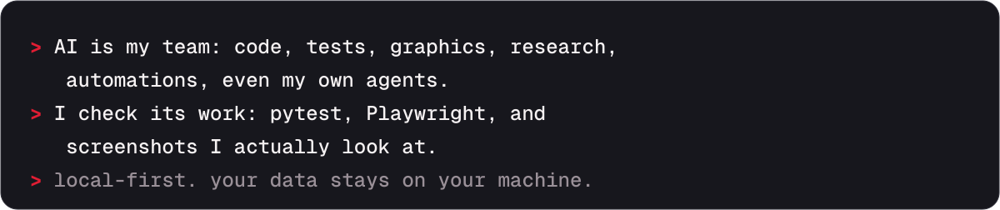

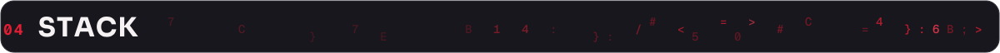
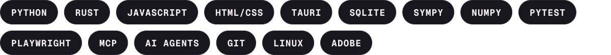

<a href="https://www.instagram.com/deadsora/">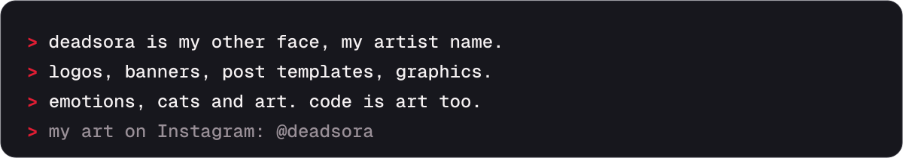</a>

<code>&lt;blackcat /&gt;</code> 🩸

